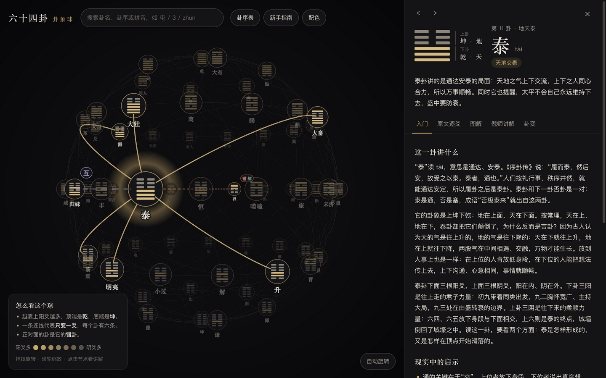

<!-- Allow this file to not have a first line heading -->
<!-- markdownlint-disable-file MD041 no-emphasis-as-heading -->

<!-- inline html -->
<!-- markdownlint-disable-file MD033 -->

<div align="center">

# `☯️ fate-graph`

**An interactive 3D sphere of the 64 I Ching hexagrams, with study notes for each one**

[](https://github.com/frankie137/fate-graph/actions/workflows/ci.yml)
[](https://frankie137.github.io/fate-graph/)
[](#license)

English | [简体中文](README.zh-CN.md)

**[Open the live site](https://frankie137.github.io/fate-graph/)**

</div>



## About

fate-graph is a web page for learning the 64 hexagrams of the I Ching (易经). The page draws the hexagrams as nodes on a sphere that you can rotate. Clicking a node opens the study notes for that hexagram.

The text of the site is in Simplified Chinese.

## Features

- **A sphere you can explore.** Drag to rotate, scroll to zoom, and click a node to select a hexagram.
- **Relations drawn on the sphere.** After you select a hexagram, solid lines mark the six hexagrams that differ from it in one line (变卦), and dashed lines mark its opposite (错卦), reversed (综卦), and nuclear (互卦) hexagrams.
- **Study notes for all 64 hexagrams**, in five tabs:
  - a beginner guide with an overview, practical advice, and a glossary of rare characters;
  - the original text line by line, each with a plain-language translation and an explanation;
  - a slot for a picture of the hexagram, which is empty for now;
  - a summary of Ni Haixia's commentary, with its sources;
  - the related hexagrams, each one click away.
- **Search** by name, King Wen number, or pinyin, for example `屯`, `3`, or `zhun`.
- **A catalog** of all 64 hexagrams and **a primer** that introduces lines, trigrams, and hexagrams.
- **Two color themes**: Ink Gold (dark) and Rice Paper (light).


## How the sphere is laid out

Three rules decide where each hexagram sits:

- The height of a node is its number of yang lines. 乾, with six yang lines, is at the top. 坤, with six yin lines, is at the bottom. The other hexagrams lie on five rings between them.
- An edge joins two hexagrams when they differ in exactly one line. Every hexagram has six edges, and the sphere has 192.
- Every hexagram sits diametrically opposite its 错卦, the hexagram with all six lines flipped.

`src/domain/layout.ts` chooses the order of the hexagrams within each ring. It searches for the order that keeps the edges short.

## Getting started

You need Node.js 24 or newer.

```sh
npm install
npm run dev
```

`npm run dev` prints a local address. Open that address in a browser.

| Command | What it does |
| --- | --- |
| `npm test` | Runs the unit tests |
| `npm run build` | Type-checks the code and builds the site into `dist/` |
| `npm run fetch:classics` | Downloads the Zhouyi text from Chinese Wikisource again |

Every push to `main` builds the site and publishes it to GitHub Pages through `.github/workflows/pages.yml`.

## Content and sources

| Tab | Files | Source |
| --- | --- | --- |
| Beginner guide (入门) | `src/content/guide/NN.json` | Written for this project |
| Original text (原文逐爻) | `src/content/classics/NN.json` | The Zhouyi on [Chinese Wikisource](https://zh.wikisource.org/wiki/周易) |
| Picture (图解) | `src/assets/tujie/NN.jpg` | No pictures yet. `src/assets/tujie/README.md` explains how to add them |
| Ni Haixia's commentary (倪师讲解) | `src/content/ni/NN.json` | Summaries of his Tianji (天纪) lectures |
| Related hexagrams (卦变) | none | Computed by `src/domain/hexagrams.ts` |

`NN` is the two-digit King Wen number of the hexagram, so `03` is 屯. `src/content/types.ts` defines the fields of each JSON file.

Please keep these limits in mind when you read the notes:

- **Original text.** The Wikisource edition differs from the received text (the Wang Bi recension that printed editions follow) in several dozen characters. `scripts/classics-corrections.json` lists these places, and the download script replaces each one with the received reading.
- **Beginner guide.** The guide was drafted with an AI assistant. It follows the mainstream commentaries of Wang Bi, Cheng Yi, and Zhu Xi, and where they disagree it takes the most common reading. Nobody has checked it line by line against printed editions. Corrections are welcome.
- **Ni Haixia's commentary.** These entries are paraphrased study notes, not his original text. They were compiled from transcriptions that circulate online, and every entry lists the pages it was compiled from. When a source lacks a part, the `note` field of the entry says which part is missing. If you hold rights to the source material and want an entry changed or removed, please open an issue.

## Project structure

| Directory | Contents |
| --- | --- |
| `src/domain/` | The table of the 64 hexagrams, the relations between them, and the layout on the sphere |
| `src/scene/` | The 3D scene, drawn with Three.js |
| `src/theme/` | The color themes |
| `src/ui/` | The search box, the detail panel, and other page components |
| `src/content/` | The text for each hexagram and the code that loads it |
| `scripts/` | The script that downloads the original text |

## Contributing

[](CODE_OF_CONDUCT.md)

We welcome community contributions to this project.

Please read our [Contributor Guide](CONTRIBUTING.md) for more information on how to get started.
Please also read our [Contributor Terms](CONTRIBUTING.md#contributor-terms) before you make any contributions.

Any contribution intentionally submitted for inclusion in this project shall be dual licensed as described below, without any additional terms or conditions.

### License

The code of this project is dual licensed under EITHER OF

- Apache License, Version 2.0, ([LICENSE-APACHE](LICENSE-APACHE) or <http://www.apache.org/licenses/LICENSE-2.0>)
- MIT license ([LICENSE-MIT](LICENSE-MIT) or <http://opensource.org/licenses/MIT>)

at your option.

The files in `src/content/classics/` are derived from Chinese Wikisource, which publishes its text under the [CC BY-SA 4.0](https://creativecommons.org/licenses/by-sa/4.0/) license. That license applies to those files.
